  

  
  
  

### `> boot medalyze --year 2030`

Healthcare runs on a revenue cycle that still depends on hold music, spreadsheets and manual keying.
**Medalyze** is rebuilding it as software: AI agents that verify eligibility, post payments and move claims forward,
with an RCM team behind them for everything a machine shouldn't decide alone.

### `> ls ./services`

| Module | What it does |
|---|---|
| `billing/` | Charge entry, claim submission and follow-up |
| `eligibility/` | Benefits and coverage checks before the visit |
| `posting/` | Payment posting from payer remittances |
| `denials/` | Denial tracking, root cause and appeals |
| `credentialing/` | Provider credentialing and payer enrollment |
| `staffing/` | Dedicated RCM staff for U.S. practices |

### `> contact --human`

Working with a U.S. practice and want fewer denials and faster payments? Reach us at **[medalyzeus.com](https://www.medalyzeus.com)**.

Medalyze Medtech LLC (St. Petersburg, FL) · Medalyze Medtech LLP (Ahmedabad, IN) · Code that touches patient data stays private.
